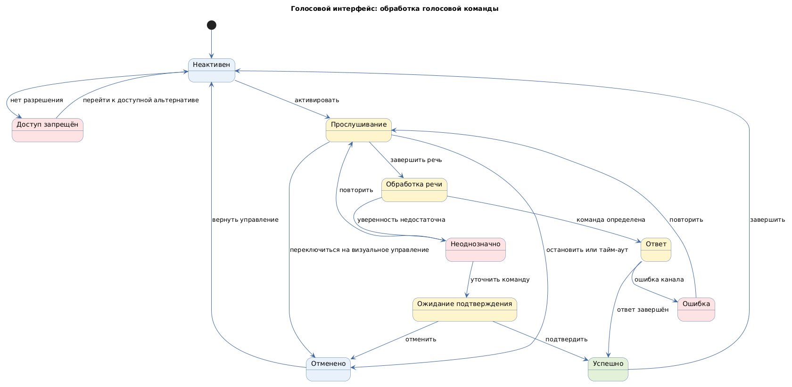

# Голосовой интерфейс (voice user interface)

Status: active  
Version: 1.0  
Pattern ID: `ui-patterns.voice.voice-interface`  
Family: `voice`  
Pattern type: `VUI_VOICE_UI`  
Decision scope: `voice-and-task`

## Определение

Голосовой интерфейс принимает речь через микрофон и возвращает голосовой или визуальный результат выполнения задачи.

## Намерение

Поддержать hands-free сценарии, в которых пользователь не может постоянно работать с экраном или клавиатурой.

## Контекст и сигналы выбора

Кандидат применим, если голос является допустимым способом ввода и вывода в среде использования. Источник не подтверждает распознавание речи, шумоустойчивость и правила приватности.

Сигналы выбора:

- hands-free сценарий;
- работа на складе, производстве или в движении;
- необходимость выполнить короткую команду без обращения к экрану;
- наличие микрофона и разрешённого голосового канала.

## Противопоказания

- среда не позволяет безопасно говорить или прослушивать ответ;
- ошибка распознавания может привести к необратимому действию без подтверждения;
- задача требует постоянного визуального сравнения или точного ввода.

## Границы решения

Карточка должна описывать активацию, распознавание, подтверждение, ответ, ошибку и повтор. Она не определяет wake word, язык, поставщика распознавания, аудиоформат, устройство или конкретную команду проекта.

## Входные данные

- голосовой канал;
- политика активации;
- поддерживаемые локали;
- политика распознавания;
- звуковая обратная связь;
- визуальная альтернатива;
- политика приватности, хранения аудио и расшифровки;
- политика подтверждения.

## Обязательные блоки

- активация: триггер, разрешение, индикатор записи и остановка;
- прослушивание: активное состояние, тайм-аут, прерывание и поведение при шуме;
- распознанная команда: расшифровка, политика уверенности и исправление;
- подтверждение: неоднозначное или опасное действие, запрос, подтверждение и отмена;
- ответ: голосовой и визуальный вывод, сигнал завершения;
- ошибка распознавания: причина, повтор, визуальная альтернатива и восстановление.

## Обязательные состояния

`inactive`, `permission-denied`, `listening`, `processing`, `ambiguous`, `awaiting-confirmation`, `responding`, `success`, `error`, `cancelled`.

## Обязательные действия и переходы

Действия: активация, речь, подтверждение, повтор, отмена, остановка прослушивания и переход к визуальному управлению.

Переходы: неактивно → прослушивание, прослушивание → обработка, обработка → неоднозначность или ответ, неоднозначность → подтверждение, подтверждение → успех, ошибка распознавания → повтор, прослушивание → отмена.

## Критерии проверки

- состояние записи и действие остановки видимы;
- ошибка распознавания имеет повтор и не голосовую альтернативу;
- опасное действие требует явного подтверждения;
- хранение аудио и расшифровки определено;
- ответ доступен в неаудиоканале, если это требуется;
- шум, пауза, прерывание и тайм-аут описаны.

## Параметры конкретного проекта

- способ активации, разрешение на микрофон и индикация записи;
- поддерживаемые локали, словарь терминов и политика уверенности распознавания;
- правила для шума, паузы, перебивания, тайм-аута и повтора;
- визуальная или текстовая альтернатива каждой существенной голосовой операции;
- согласие, срок хранения аудио и расшифровки, удаление и доступ к данным;
- требования доступности и безопасности среды;
- допустимая задержка ответа и поведение при недоступности голосового канала.

Значения фиксируются в UI-спецификации проекта. Универсальные значения без входных требований не задаются.

## Минимальный прототип

Прототип должен показать состояния `inactive`, `listening`, `processing`, `ambiguous`, `awaiting-confirmation`, `error` и `success`, а также переход к визуальному управлению и остановку записи.

## Диаграмма основного поведения

<!-- Исходный код: голосовой-интерфейс.plantuml -->

## Совместимость

Может использоваться вместе с `MOBILE_TOUCH_UI`, `STATEFUL_ACTION_UI` и `ROLE_BASED_UI` после подтверждения platform-specific ограничений.

## Происхождение

- Голосовой контракт опирается на нормализованные требования VoiceXML и SRGS.
- Конкретные правила распознавания, приватности и среды остаются проектными входами.

## Проверка

- Все параметры конкретного проекта заполнены или оформлены как `GAP`.
- Для существенных действий есть подтверждение, остановка и не голосовая альтернатива.
- Прототип показывает запись, распознавание, неоднозначность, ошибку и восстановление.
- Хранение аудио и расшифровки связано с согласиями и правилами удаления.
- Состояния, действия и переходы совпадают с application template.
