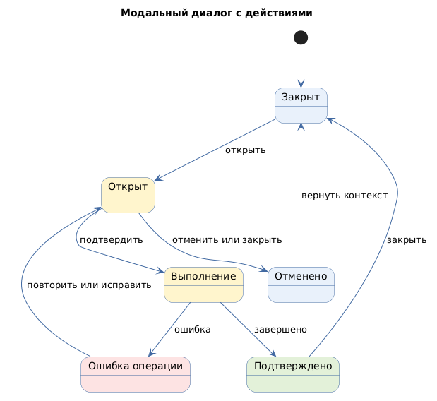

# Модальный диалог с действиями

Status: active  
Version: 1.0  
Pattern ID: `ui-patterns.dialogs.modal-dialog`  
Family: `dialogs`  
Pattern type: `DIALOG_OVERLAY_UI`  
Decision scope: `screen-block`

## Определение

Модальный диалог (modal dialog) временно фокусирует внимание на заголовке, содержимом и действиях поверх текущего контекста.

## Намерение

Обеспечить короткое контекстное взаимодействие, подтверждение или ввод данных без перехода на отдельный экран.

## Контекст и сигналы выбора

Паттерн применим, если действие требует временного фокуса и его содержимое можно выполнить в ограниченной области.

Сигналы выбора:

- подтверждение операции;
- короткая контекстная форма;
- асинхронное завершение действия;
- необходимость явно разделить подтверждение и отмену.

## Условия выбора и противопоказания

Выбирать паттерн следует, когда действие или короткое содержимое требует временного фокуса поверх текущего контекста. Паттерн противопоказан для длительного чтения, сложной навигации или действия, которое можно выполнить без прерывания текущего контекста.

## Границы решения

Паттерн описывает overlay-блок, его действия и переходы закрытия. Он не определяет содержание операции, права пользователя, текст подтверждения или бизнес-правила.

## Структура

- заголовок;
- область содержимого;
- основное действие;
- вторичное действие или отмена;
- состояние выполнения;
- закрытие и возврат в исходный контекст.

## Состояния и переходы

Подтверждённые источником состояния:

- `closed`;
- `open`;
- `loading`;
- `asynchronous-close`.

Нормализованные переходы:

```text
closed → open
open → confirm
open → cancel
open → error
open → closed
```

Состояния `permission-denied` и `operation-error` требуют проектных требований.

## Последствия и ограничения

Положительные последствия:

- временный фокус на одной операции;
- явная область действий;
- возможность показать состояние выполнения.

Ограничения:

- сложное или длинное содержимое плохо подходит для ограниченной области;
- требуется определить закрытие, отмену и возврат в исходный контекст;
- форма внутри диалога требует отдельной проверки сохранения и валидации.

## Accessibility и responsive

Источник не заменяет полный контракт управления фокусом, клавиатурой и экранным диктором. Эти правила являются `GAP` до подтверждения требованиями целевого проекта.

Размер диалога, прокрутка и мобильное поведение также требуют отдельного responsive-решения.

## Совместимость

Совместим с `ui-patterns.forms.form-data-entry-validation`, если форма короткая и контекстная. При сложном процессе следует рассмотреть отдельный экран или workflow-паттерн.

## Иллюстративный пример

Конкретные операции и названия сущностей не приводятся. Поле `examples.status` в индексе имеет значение `illustrative`.

## Влияние на документацию

При применении необходимо зафиксировать цель диалога, содержимое, действия, правила закрытия, состояния выполнения и ошибки.

## Происхождение

- [Ant Design Modal](https://ant.design/components/modal/) — `SRC-ANT-MODAL`, `E-ANT-MODAL-001`.
- Правила UI-спецификации нормализованы в публичном `pattern-catalog.yml` и связанной процедуре выбора.

## Проверка

- Проверить необходимость модального режима.
- Проверить primary action, cancel и dismiss behavior.
- Проверить переходы `closed`, `open`, `loading`, `error` и `closed`.
- Отдельно проверить фокус, клавиатуру, экранный диктор и мобильное поведение.

## Диаграмма основного поведения

<!-- Исходный код: модальный-диалог.plantuml -->

