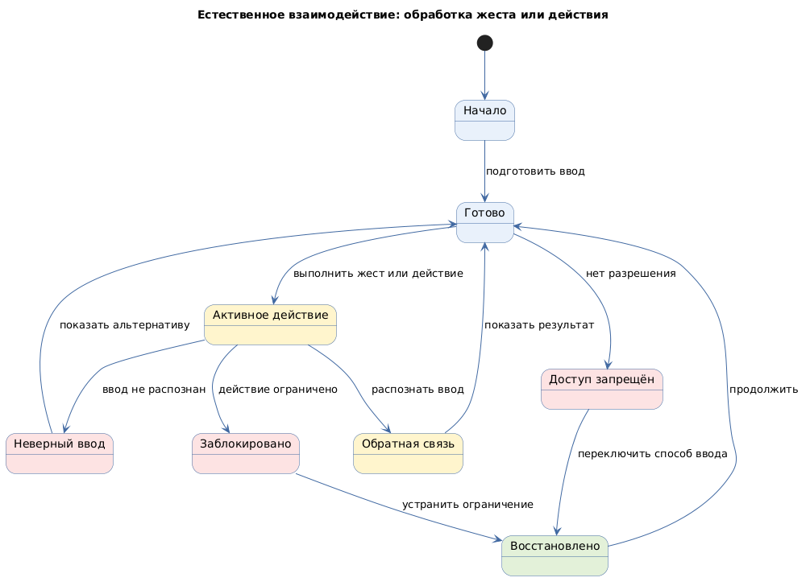

# Естественное взаимодействие (natural user interface)

Status: active  
Version: 1.0  
Pattern ID: `ui-patterns.natural-interaction.natural-interface`  
Family: `natural-interaction`  
Pattern type: `NUI_NATURAL_INTERACTION_UI`  
Decision scope: `input-and-spatial-interaction`

## Определение

Естественное взаимодействие использует жесты, касания, пространственное или другое близкое пользователю действие вместо единственного традиционного указателя и клавиатуры.

## Намерение

Поддержать мобильные, touch-, AR- и VR-сценарии, в которых способ взаимодействия определяется физической средой и устройством.

## Контекст и сигналы выбора

Кандидат применим, если пользовательская задача зависит от жеста, пространственного положения или другого natural input. Направление пересекается с `MOBILE_TOUCH_UI` и не должно становиться отдельным активным паттерном без подтверждения границ.

Сигналы выбора:

- touch или жестовое управление;
- пространственная или иммерсивная среда;
- необходимость взаимодействия без стандартной клавиатуры и указателя;
- контекст, в котором важны положение, движение или объект взаимодействия.

## Противопоказания

- существенное действие доступно только через скрытый жест;
- нет видимой или доступной альтернативы natural input;
- устройство, пространство и ограничения безопасности не подтверждены.

## Границы решения

Карточка должна описывать карту ввода, обратную связь, альтернативный способ действия, доступность, безопасность и конфликт системных жестов. Она не определяет конкретную платформу, устройство, AR/VR SDK или дизайн-систему.

## Входные данные

- устройство и платформа;
- физическая среда;
- карта ввода;
- цели взаимодействия;
- политика обратной связи;
- альтернативный способ ввода;
- профиль доступности и политика безопасности.

## Обязательные блоки

- область ввода: канал, активная область и конфликт системных жестов;
- цель взаимодействия: идентификатор, состояние, достижимость и действие;
- естественное действие: жест или пространственное действие, триггер, отмена и альтернатива;
- обратная связь: визуальная, звуковая или тактильная, время и сообщение об ошибке;
- альтернативный контрол: эквивалентное действие, доступность и порядок фокуса;
- безопасность и восстановление: случайная активация, блокировка и восстановление.

## Обязательные состояния

`initial`, `ready`, `active`, `feedback`, `invalid-input`, `blocked`, `permission-denied`, `recovered`.

## Обязательные действия и переходы

Действия: выполнение ввода, подтверждение, отмена, смена способа ввода и восстановление.

Переходы: готовность → активность, активность → обратная связь, активность → неверный ввод, активность → блокировка, обратная связь → готовность, блокировка → восстановление, отказ в разрешении → альтернативный ввод.

## Критерии проверки

- естественное взаимодействие не дублирует мобильное сенсорное без обоснования;
- существенное действие имеет видимую альтернативу;
- конфликты системных жестов проверены;
- ограничения устройства, среды и безопасности определены;
- обратная связь показывает результат действия;
- доступность и альтернативный ввод проверяемы.

## Параметры конкретного проекта

- граница с `MOBILE_TOUCH_UI`;
- подтверждённые жесты и пространственные действия;
- устройство, платформа, физическая среда и ограничения безопасности;
- достижимость целей и доступность альтернативного ввода;
- конфликты системных жестов и случайная активация;
- визуальная, звуковая или тактильная обратная связь;
- проверка в реальном физическом контексте.

Значения фиксируются в UI-спецификации проекта. AR/VR и spatial-сценарии не предполагаются без подтверждённого контекста.

## Минимальный прототип

Прототип должен показать готовую цель, активное естественное действие, обратную связь, неверный ввод, блокировку, альтернативный контрол и восстановление.

## Диаграмма основного поведения

<!-- Исходный код: естественный-интерфейс.plantuml -->

## Совместимость

Может использоваться вместе с `MOBILE_TOUCH_UI`, `RESPONSIVE_UI` и `STATEFUL_ACTION_UI` после фиксации отдельного input-контракта.

## Происхождение

- Аппаратно-независимый указательный ввод нормализован по W3C Pointer Events.
- Альтернативы сложным жестам и клавиатурный доступ нормализованы по WCAG 2.2.
- Устройство, среда и безопасность остаются проектными входами.

## Проверка

- Все параметры конкретного проекта заполнены или оформлены как `GAP`.
- Отличие от `MOBILE_TOUCH_UI` обосновано устройством, средой или способом ввода.
- Для существенного действия предусмотрена доступная альтернатива.
- Прототип показывает обратную связь, блокировку, ошибку и восстановление.
- Состояния, действия и переходы совпадают с application template.
