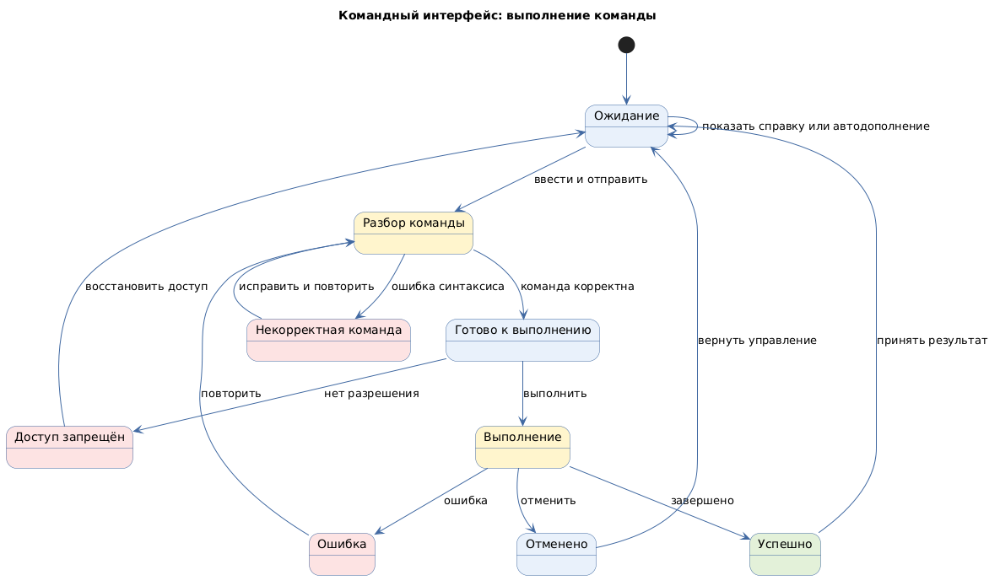

# Командный интерфейс (command-line interface)

Status: active  
Version: 1.0  
Pattern ID: `ui-patterns.command-line.command-interface`  
Family: `command-line`  
Pattern type: `CLI_COMMAND_UI`  
Decision scope: `interaction-and-command`

## Определение

Командный интерфейс принимает текстовые команды пользователя и возвращает результат выполнения, ошибку или справочную информацию.

## Намерение

Обеспечить управление системой через терминал для административных операций, автоматизации и повторяемых командных сценариев.

## Контекст и сигналы выбора

Кандидат применим, если пользователь или автоматизированный процесс должен выполнять команды через терминал. Источник не подтверждает полный контракт синтаксиса, безопасности и интерактивного поведения.

Сигналы выбора:

- административная или автоматизированная операция;
- необходимость повторяемого запуска команды;
- работа через терминал или удалённую сессию;
- необходимость использовать интерфейс без графического экрана.

## Противопоказания

- задача требует визуального сравнения или пространственной композиции;
- пользователь не может безопасно интерпретировать команду и её результат;
- критическая операция не имеет подтверждения, отмены или восстановления.

## Границы решения

Карточка должна описывать команду, аргументы, вывод, ошибки, справку, права и повторный запуск. Она не определяет язык команд, shell, операционную систему, API или конкретные административные операции проекта.

## Входные данные

- идентификатор интерфейса;
- среда выполнения;
- роли пользователей;
- модель команды и синтаксис;
- контракт вывода;
- политика безопасности;
- политика аудита;
- политика длительной операции.

## Обязательные блоки

- ввод команды: синтаксис, аргументы, экранирование, автодополнение и история;
- справка по команде: область, вызов и правила примеров;
- проверка команды: этап проверки, формат ошибки и путь исправления;
- вывод результата: формат, идентичность, порядок и машинно-читаемый режим;
- обратная связь операции: этап, прогресс, завершение и отмена;
- подтверждение опасного действия: условие, объяснение, подтверждение и восстановление.

## Обязательные состояния

`idle`, `parsing`, `invalid-command`, `ready`, `running`, `success`, `error`, `cancelled`, `permission-denied`.

## Обязательные действия и переходы

Действия: ввод команды, показ справки, автодополнение, выполнение, подтверждение опасного действия, отмена и повтор.

Переходы: ожидание → разбор, разбор → недопустимая команда, разбор → готовность, готовность → выполнение, выполнение → успех, выполнение → ошибка, выполнение → отмена, отказ в доступе → восстановление.

## Критерии проверки

- контракт команды и аргументов определён;
- синтаксическая ошибка указывает путь исправления;
- опасные операции требуют подтверждённого намерения;
- политика безопасности и аудита явно зафиксирована;
- отказ в доступе не раскрывает чувствительные сведения;
- объявлены человеко-читаемый и машинно-читаемый режимы вывода;
- длительная операция имеет прогресс или объяснение текущего состояния;
- отмена и повтор не дублируют побочные эффекты;
- документированы код завершения и контракт ошибки.

## Параметры конкретного проекта

- синтаксис команд, правила экранирования и формат аргументов;
- автодополнение, история и повторный запуск;
- интерактивный и неинтерактивный режим;
- человеко-читаемый и машинно-читаемый вывод;
- источник авторизации, политика безопасности и состав audit trail;
- длительные операции, отмена, повтор и частичный результат;
- коды завершения и формат диагностических сообщений.

Значения фиксируются в UI-спецификации проекта. Универсальные команды, роли и политики без входных требований не задаются.

## Минимальный прототип

Прототип должен показать ввод команды, справку, ошибку синтаксиса, выполнение с прогрессом, успешный результат, отмену, отказ в доступе и подтверждение опасной операции.

## Диаграмма основного поведения

<!-- Исходный код: командный-интерфейс.plantuml -->

## Совместимость

Может использоваться вместе с `ROLE_BASED_UI`, `STATEFUL_ACTION_UI` и техническими инструментами проекта после отдельного подтверждения границ.

## Происхождение

- Синтаксис аргументов и диагностирование ошибок нормализованы по POSIX Utility Conventions.
- Безопасность, аудит и конкретные операции остаются проектными входами.

## Проверка

- Все параметры конкретного проекта заполнены или оформлены как `GAP`.
- Синтаксис, коды завершения и диагностические сообщения согласованы.
- Опасные операции требуют подтверждения, а отмена и повтор не дублируют побочные эффекты.
- Прототип показывает успешный, ошибочный, запрещённый и длительный сценарии.
- Состояния, действия и переходы совпадают с application template.
