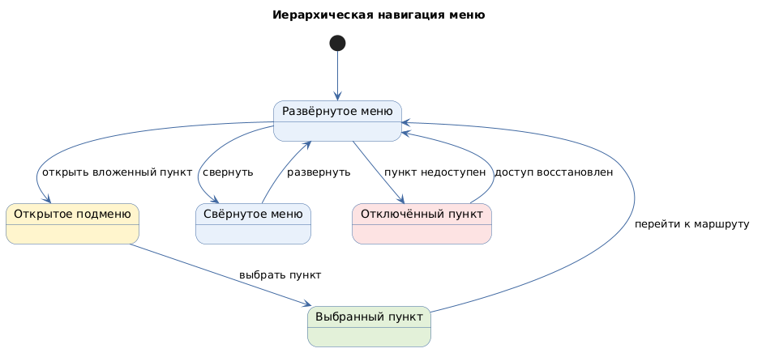

# Иерархическая навигация меню

Status: active  
Version: 1.0  
Pattern ID: `ui-patterns.navigation.menu-navigation`  
Family: `navigation`  
Pattern type: `NAVIGATION_CONTENT_UI`  
Decision scope: `screen-block`

## Определение

Иерархическая навигация меню (hierarchical menu navigation) предоставляет переходы по разделам через верхнюю, боковую или вложенную структуру меню.

## Намерение

Помочь пользователю находить разделы и переходить между ними, сохраняя выбранный пункт и состояние вложенных меню.

## Контекст и сигналы выбора

Паттерн применим, если существует несколько разделов или маршрутов, между которыми пользователь должен перемещаться.

Сигналы выбора:

- иерархия разделов;
- верхняя или боковая навигация;
- активный пункт;
- вложенные пункты;
- необходимость свернутого режима.

## Условия выбора и противопоказания

Выбирать паттерн следует при наличии нескольких разделов или маршрутов, между которыми нужно перемещаться. Паттерн противопоказан для единственного линейного перехода или сценария, где навигация не образует структуру разделов.

## Границы решения

Паттерн описывает структуру меню и состояния его пунктов. Он не определяет маршруты, роли, права доступа и конкретные названия разделов.

## Структура

- корневое меню;
- пункты меню;
- вложенные пункты;
- выбранный пункт;
- открытые подменю;
- свернутый режим.

## Состояния и переходы

Подтверждённые источником состояния:

- `selected`;
- `opened-submenu`;
- `collapsed`;
- `disabled`.

Нормализованные переходы:

```text
menu-item → route
closed-submenu → open-submenu
expanded-menu → collapsed-menu
```

Состояния `unauthorized-route` и `unavailable-route` требуют проектных требований.

## Последствия и ограничения

Положительные последствия:

- поддержка верхней и боковой организации навигации;
- явное состояние выбранного пункта;
- поддержка вложенной структуры.

Ограничения:

- вложенность требует правил открытия, закрытия и возврата;
- адаптивное сворачивание должно быть согласовано с `viewport`;
- доступ к маршрутам не должен выводиться из одной только структуры меню.

## Accessibility и responsive

Источник подтверждает семантическую структуру `Menu`, но не заменяет проектный контракт клавиатуры, фокуса и экранного диктора. Эти правила зафиксированы как `GAP`.

Источник подтверждает collapsed inline mode. Конкретные breakpoint-правила и мобильная навигация требуют отдельного решения.

## Совместимость

Совместим с `ui-patterns.lists.data-table`, если таблица является содержимым выбранного раздела.

## Иллюстративный пример

Конкретные маршруты и названия разделов не приводятся. Поле `examples.status` в индексе имеет значение `illustrative`.

## Влияние на документацию

При применении необходимо зафиксировать маршруты, владельцев разделов, выбранный пункт, открытые подменю, права доступа и responsive-поведение.

## Происхождение

- [Ant Design Menu](https://ant.design/components/menu/) — `SRC-ANT-MENU`, `E-ANT-MENU-001`, `E-ANT-MENU-002`.
- Правила UI-спецификации нормализованы в публичном `pattern-catalog.yml` и связанной процедуре выбора.

## Проверка

- Проверить соответствие пунктов меню маршрутам.
- Проверить выбранный пункт и открытие вложенных меню.
- Проверить свернутый режим.
- Отдельно проверить клавиатуру, фокус, экранный диктор и права доступа.

## Диаграмма основного поведения

<!-- Исходный код: навигация-меню.plantuml -->

