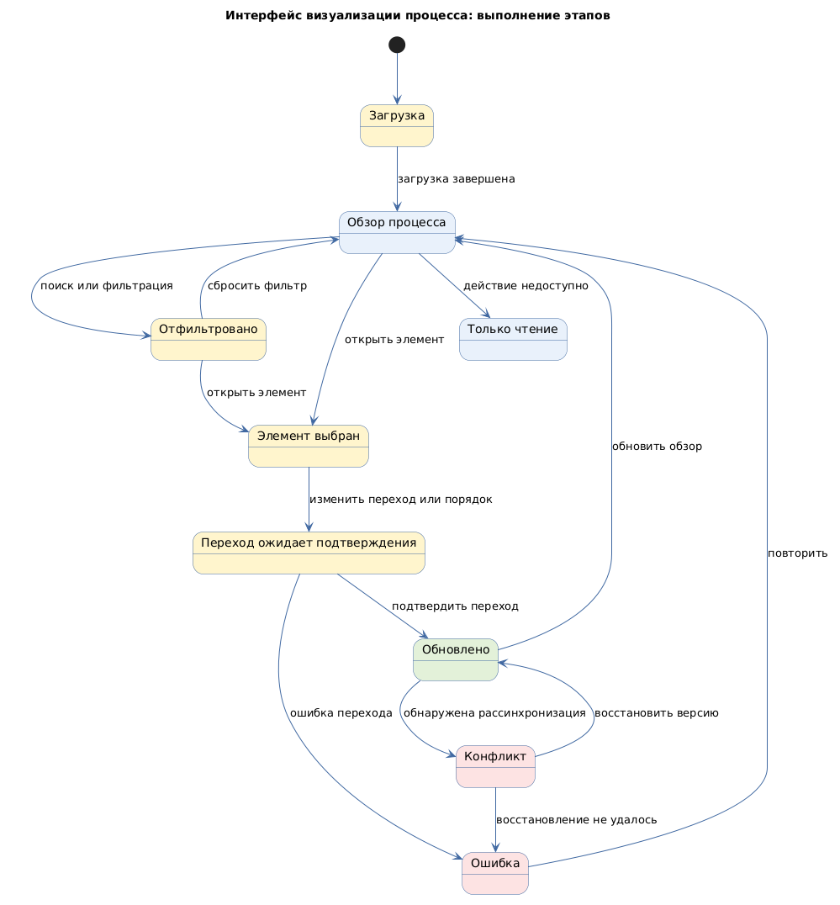

# Интерфейс визуализации процесса (workflow process interface)

Status: active  
Version: 1.0  
Pattern ID: `ui-patterns.processes.workflow-process-interface`  
Family: `processes`  
Pattern type: `WORKFLOW_PROCESS_UI`  
Decision scope: `process-visualization-and-action`

## Определение

Интерфейс визуализации процесса показывает этапы, состояния, связи и действия над рабочим процессом через канбан-доску, схему потока или другую процессную композицию.

## Намерение

Помочь пользователю понимать текущий процесс, находить элементы на его этапах и выполнять разрешённые переходы.

## Контекст и сигналы выбора

Кандидат применим, если пользователь должен наблюдать или изменять последовательность этапов и состояний процесса. Он отличается от `multi-step-workflow-ui`: тот описывает прохождение одной задачи, а этот паттерн — визуализацию и управление процессом как структурой.

Сигналы выбора:

- этапы и статусы процесса;
- канбан-доска или схема потока;
- переходы между состояниями;
- необходимость видеть процесс целиком и открывать детали элемента.

## Противопоказания

- процесс имеет только линейный короткий переход без необходимости обзора;
- визуальная схема не помогает принять решение или выполнить действие;
- правила переходов, права и источник состояния не определены.

## Границы решения

Карточка должна описывать процессную структуру, узлы, связи, статусы, действия перехода, фильтрацию, детали и ошибки синхронизации. Она не определяет BPMN, конкретные бизнес-процессы, правила ролей или способ хранения состояния.

## Входные данные

- модель процесса;
- типы узлов и этапов;
- модель статусов;
- правила переходов;
- права на действия;
- фильтрация и поиск;
- политика синхронизации;
- правила масштабирования и переполнения.

## Обязательные блоки

- рабочая область процесса: представление, этапы или узлы, связи, масштабирование или прокрутка;
- этап или колонка: идентификатор, порядок, условие входа и условие выхода;
- элемент процесса: идентификатор, краткое описание, статус, владелец или область ответственности, переход к деталям;
- управление переходом: доступность, подтверждение, успешный результат и ошибка;
- фильтры процесса: поля, запуск, сброс и пустой результат;
- детали элемента: идентичность, данные, доступные действия и возврат;
- сообщение о конфликте: тип конфликта, текущая версия и действие восстановления.

## Обязательные состояния

`loading`, `overview`, `filtered`, `item-selected`, `transition-pending`, `updated`, `read-only`, `conflict`, `error`.

## Обязательные действия и переходы

Действия: просмотр, поиск, фильтрация, открытие деталей, переход, изменение порядка или перетаскивание, повтор и восстановление.

Переходы: загрузка → обзор, обзор → фильтрация, обзор → выбранный элемент, элемент → детали, элемент → ожидание перехода, переход → обновление, переход → ошибка, конфликт → восстановление.

## Критерии проверки

- модель процесса и переходы между состояниями определены;
- граница с `multi-step-workflow-ui` сохранена;
- каждый переход имеет правила прав и восстановления;
- обзор и детали сохраняют идентичность элемента;
- конфликт синхронизации видим и допускает восстановление;
- для большой структуры определено поведение переполнения;
- для drag-and-drop предусмотрено доступное альтернативное управление, если он используется.

## Параметры конкретного проекта

- представление процесса: Kanban, flowchart или другой подтверждённый формат;
- вложенность, размер схемы, фильтрация и поведение переполнения;
- drag-and-drop и доступное альтернативное управление;
- совместное редактирование, версия данных и конфликт обновления;
- права переходов, аудит и восстановление;
- responsive, keyboard и accessibility для большой структуры;
- связь обзора, списка и детального просмотра элемента.

Значения фиксируются в UI-спецификации проекта. BPMN и Kanban не определяют конкретную бизнес-модель или UI-компоненты проекта.

## Минимальный прототип

Прототип должен показать обзор процесса, этапы или узлы, элемент, фильтрацию, детали, разрешённый переход, отказ, конфликт синхронизации и восстановление.

## Диаграмма основного поведения

<!-- Исходный код: интерфейс-визуализации-процесса.plantuml -->

## Совместимость

Может использоваться вместе с `LIST_DETAIL_UI`, `DASHBOARD_MONITORING_UI`, `INFORMATION_ARCHITECTURE_UI`, `STATEFUL_ACTION_UI` и `ROLE_BASED_UI` после подтверждения границ.

## Происхождение

- Модель процесса и границы нотации нормализованы по BPMN 2.0.2.
- Этапы, карточки и визуализация рабочего потока нормализованы по официальному описанию Kanban board.
- Права, синхронизация и конкретные процессы остаются проектными входами.

## Проверка

- Все параметры конкретного проекта заполнены или оформлены как `GAP`.
- Граница с `multi-step-workflow-ui` и `LIST_DETAIL_UI` видима в прототипе.
- Прототип показывает переход, отказ, конфликт и восстановление.
- Для drag-and-drop предусмотрена доступная альтернатива, если он используется.
- Состояния, действия и переходы совпадают с application template.
