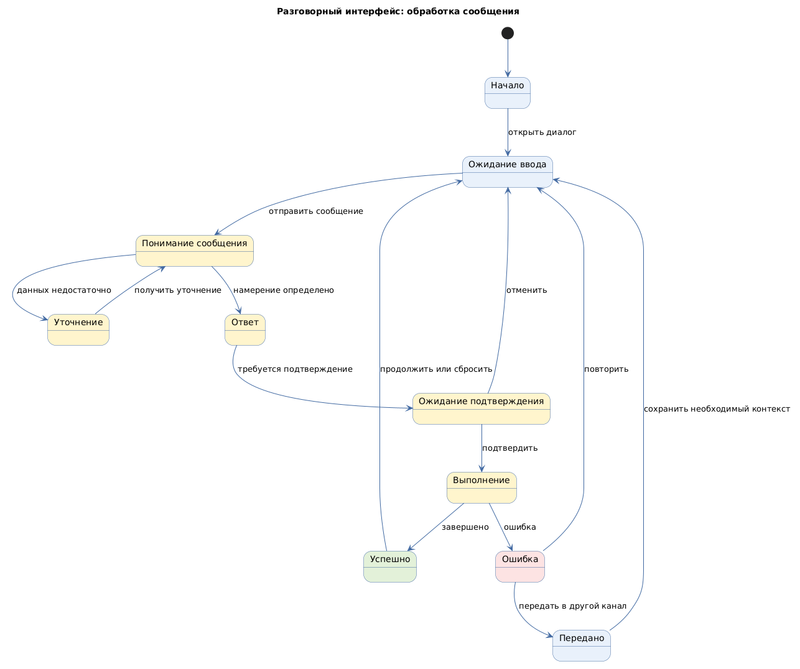

# Разговорный интерфейс (conversational user interface)

Status: active  
Version: 1.0  
Pattern ID: `ui-patterns.conversational.conversational-interface`  
Family: `conversational`  
Pattern type: `CUI_CONVERSATIONAL_UI`  
Decision scope: `conversation-and-task`

## Определение

Разговорный интерфейс принимает сообщения пользователя в форме диалога и возвращает ответы, уточнения, результат или передачу задачи другому каналу.

## Намерение

Поддержать поиск, консультацию, onboarding и выполнение коротких задач через последовательность сообщений.

## Контекст и сигналы выбора

Кандидат применим, если пользовательскую задачу удобно выполнять через вопросы и ответы, а системе необходимо уточнять намерение или недостающие данные. Источник не подтверждает контракт контекста, генерации ответов и передачи оператору.

Сигналы выбора:

- поддержка или консультация;
- поиск по содержимому через естественный язык;
- последовательное уточнение задачи;
- необходимость продолжить диалог после промежуточного результата.

## Противопоказания

- критическая операция не имеет явного подтверждения и обратимого результата;
- точность команды важнее удобства свободного диалога;
- пользователь должен одновременно сравнивать много структурированных данных.

## Границы решения

Карточка должна описывать сообщения, намерения, контекст диалога, уточнения, ошибки понимания, переход к оператору и завершение задачи. Она не определяет модель, провайдера, промпты, бизнес-правила и персональные данные проекта.

## Входные данные

- идентификатор диалога;
- цель пользователя;
- модель намерений;
- политика хранения контекста;
- политика приватности;
- политика подтверждения действий;
- политика повторной попытки и передачи в другой канал.

## Обязательные блоки

- оболочка диалога: точка входа, порядок сообщений, индикатор контекста и сброс;
- сообщение пользователя: способ ввода, содержание, проверка и отправка;
- ответ системы: содержание, основание или источник, статус и следующие действия;
- уточнение: неоднозначность, вопрос, варианты ответа и путь исправления;
- подтверждение действия: действие, последствия, подтверждение и отмена;
- повторная попытка и передача: причина ошибки, повтор, альтернативный канал и статус передачи.

## Обязательные состояния

`initial`, `waiting-input`, `understanding`, `clarifying`, `responding`, `awaiting-confirmation`, `executing`, `success`, `error`, `handed-off`.

## Обязательные действия и переходы

Действия: отправка, уточнение, подтверждение, отмена, повтор, сброс и передача.

Переходы: начало → ожидание ввода, сообщение → понимание, понимание → уточнение, понимание → ответ, ответ → подтверждение, подтверждение → выполнение, выполнение → успех, ошибка → повтор или передача.

## Критерии проверки

- цель и контекст диалога видимы;
- неоднозначность имеет явный путь уточнения;
- действие с внешним эффектом требует подтверждения;
- основание или источник ответа фиксируется, если это требуется;
- ошибка не оставляет пользователя без восстановления;
- хранение и удаление контекста определены;
- передача сохраняет нужный контекст и не раскрывает приватные данные.

## Параметры конкретного проекта

- модель намерений и срок хранения контекста;
- правила уточнения неоднозначности и коррекции ответа;
- отображение основания, источника или уверенности ответа, если это требуется;
- подтверждение действий с внешним эффектом;
- история диалога, удаление данных и приватность;
- повторная попытка, передача оператору и восстановление;
- ограничения на использование персональных и чувствительных данных.

Значения фиксируются в UI-спецификации проекта. Модель, провайдер и промпты проекта не переносятся в публичную карточку.

## Минимальный прототип

Прототип должен показать начало диалога, ввод, ответ, уточнение, подтверждение действия, ошибку, повтор, сброс и передачу в другой канал.

## Диаграмма основного поведения

<!-- Исходный код: разговорный-интерфейс.plantuml -->

## Совместимость

Может использоваться вместе с `INFORMATION_ARCHITECTURE_UI`, `PROGRESSIVE_ONBOARDING_UI` и `ROLE_BASED_UI` после подтверждения соответствующих шаблонов.

## Происхождение

- Требования к текстовой альтернативе и просмотру истории диалога нормализованы по W3C Natural Language Interface Accessibility User Requirements.
- Модель намерений, приватность и передача оператору остаются проектными входами.

## Проверка

- Все параметры конкретного проекта заполнены или оформлены как `GAP`.
- Неоднозначность имеет явный путь уточнения, а внешнее действие — подтверждение.
- История, удаление и приватность контекста определены.
- Прототип показывает восстановление после ошибки и передачу контекста без раскрытия приватных данных.
- Состояния, действия и переходы совпадают с application template.
