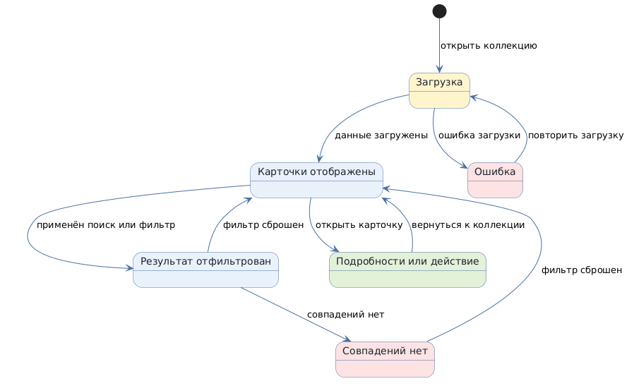

# Карточная лента коллекции

Status: active
Version: 1.0
Pattern ID: `ui-patterns.lists.card-feed`
Family: `lists`
Pattern type: `LIST_DETAIL_UI`
Decision scope: `screen-block`

## Определение

Карточная лента (card feed) представляет элементы коллекции самостоятельными карточками, расположенными в сетке. Карточка объединяет сведения об одном элементе; её состав может включать заголовок, краткое содержание, метаданные и подтверждённый проектом медиаслот.

Паттерн относится к тому же семейству списков, что и таблица, но не является её визуальной вариацией: карточка не требует одинакового набора колонок для сопоставления значений.

## Намерение

Дать пользователю возможность быстро просматривать коллекцию как отдельные визуально сгруппированные элементы и открывать нужный элемент или доступное для него действие.

## Контекст и сигналы выбора

Выбирать карточную ленту, если:

- коллекция состоит из самостоятельных элементов с несколькими связанными сведениями;
- эти сведения удобнее воспринимать внутри карточки, чем сопоставлять по единым колонкам;
- содержимое карточек может различаться по объёму или составу;
- проект подтвердил порядок, действия и условия перестроения сетки.

Официальные примеры Material Design 3 описывают Feed как настраиваемую сетку карточек для быстрого просмотра содержимого и показывают варианты для областей compact, medium и expanded. Эти категории не задают универсальные значения CSS px и не заменяют решения по областям отображения (viewport) проекта.

## Условия выбора и противопоказания

Выбирать паттерн, когда пользователь просматривает самостоятельные элементы, а важная для него информация логически группируется внутри каждой карточки.

Не выбирать карточную ленту вместо табличного представления, если задача пользователя требует сравнивать одноимённые поля между элементами, сортировать общие колонки или выполнять плотные операции над строками. Для такого случая предназначен `ui-patterns.lists.data-table`.

Сам факт наличия карточной визуальной оболочки не подтверждает применимость паттерна. Решение должно опираться на пользовательскую задачу, структуру данных и условия просмотра.

## Границы решения

Паттерн задаёт структуру карточной коллекции и вопросы, которые требуется разрешить. Он не определяет сущности, поля, изображения, права доступа, API, бизнес-правила, число колонок или размеры экранов конкретного проекта.

## Структура

- заголовок и назначение коллекции;
- элементы управления поиском или фильтрацией, если они требуются;
- адаптивная сетка карточек;
- идентичность и содержание каждой карточки;
- переход к подробностям или подтверждённому действию;
- состояния загрузки, пустого результата, пустого результата фильтрации, ошибки и восстановления.

Медиа-содержимое, пагинация и другие способы загрузки добавляются только при подтверждении требованиями проекта.

## Состояния и переходы

Для выбранного решения необходимо определить применимость состояний `loading`, `populated`, `empty`, `filtered-empty`, `error` и `disabled-action`.

Основные переходы:

```text
loading → populated | error
populated → filtered | item-detail-or-action
filtered → populated | filtered-empty
error → retry
```

Поиск, фильтрация, действия и восстановление включаются в спецификацию только если подтверждены для конкретного экрана.

## Последствия и ограничения

Положительные последствия:

- связанные сведения элемента остаются сгруппированными;
- сетка может менять размещение карточек в соответствии с подтверждёнными условиями viewport;
- отдельные карточки могут содержать различный объём содержания.

Ограничения:

- карточки хуже подходят для точного сравнения общих полей между множеством элементов;
- количество карточек в строке, порядок и перестроение сетки требуют решения для каждой подтверждённой области отображения (viewport);
- дополнительные карточные действия могут повышать визуальную и когнитивную нагрузку;
- загрузка, пустые состояния, клавиатурная навигация и доступность должны быть проверены по требованиям проекта.

## Доступность (accessibility) и адаптивное поведение (responsive behavior)

Эталон содержит семантическую коллекцию и карточки, доступные для клавиатурного взаимодействия; состояния результата и ошибки объявляются через области `status` и `alert`. Это reference-поведение, а не законченный accessibility-контракт проекта.

Сетка в эталоне демонстрирует перестроение CSS-layout. Её ширина карточки и точки перестроения (breakpoints) являются иллюстративной реализацией шаблона, а не рекомендацией размера устройства. В проекте используются только области отображения, источники и условия перестроения, подтверждённые в пуле экранов (screen pool).

## Эталон



Запускаемый HTML/CSS/JS-пример находится в `шаблоны-экранов/карточная-лента/` и использует только тестовые данные-заглушки (fixture data). Он демонстрирует общий каркас, фильтрацию, состояния и перестроение сетки; он не является готовым интерфейсом продукта.

## Источники

- Material Design 3, Canonical layout examples: <https://m3.material.io/foundations/layout/canonical-examples/overview>.
