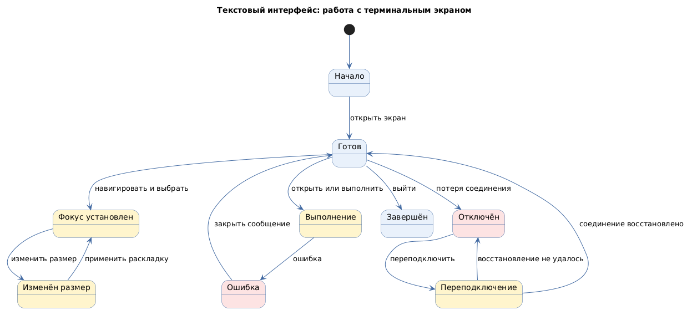

# Текстовый интерфейс с псевдографикой (text-based user interface)

Status: active  
Version: 1.0  
Pattern ID: `ui-patterns.text.text-interface`  
Family: `text`  
Pattern type: `TUI_TEXT_UI`  
Decision scope: `terminal-screen`

## Определение

Текстовый интерфейс с псевдографикой использует терминальное окно, текстовые панели, меню и клавиатурную навигацию вместо графических компонентов.

## Намерение

Обеспечить полноэкранное управление и просмотр информации в терминале при ограниченной графической среде.

## Контекст и сигналы выбора

Кандидат применим для лёгких утилит, серверных панелей и удалённого администрирования. Источник не подтверждает различия между TUI, CLI и конкретными terminal UI toolkit.

Сигналы выбора:

- работа через SSH или ограниченный терминал;
- необходимость нескольких текстовых областей и меню;
- управление клавиатурой без графического viewport;
- требование минимального потребления ресурсов.

## Противопоказания

- задача требует сложной графики, диаграмм или свободного пространственного сравнения;
- терминал не поддерживает необходимые размеры, символы или управление;
- критические действия не имеют видимого состояния и восстановления.

## Границы решения

Карточка должна описывать экран терминала, панели, меню, фокус, клавиатурные действия, изменение размера и текстовые состояния. Она не определяет terminal UI toolkit, shell, кодировку или команды проекта.

## Входные данные

- среда терминала;
- минимальный размер терминала;
- компоновка панелей;
- карта клавиш;
- политика фокуса;
- кодировка и локализация;
- политика восстановления сессии.

## Обязательные блоки

- оболочка терминала: заголовок, статус, выход и ограничения терминала;
- панель содержимого: идентификатор, назначение, содержимое и прокрутка;
- меню или список: элементы, выбор, клавиатурные действия и недоступные элементы;
- область сообщений: тип, приоритет, хранение и восстановление;
- индикатор фокуса: текущий элемент, порядок и восстановление;
- восстановление сессии: отключение, переподключение и сохранение данных.

## Обязательные состояния

`initial`, `ready`, `focused`, `resized`, `running`, `error`, `disconnected`, `reconnecting`, `exited`.

## Обязательные действия и переходы

Действия: навигация, выбор, открытие, изменение размера, отмена, переподключение и выход.

Переходы: начало → готовность, готовность → фокус, фокус → изменение размера, готовность → выполнение, выполнение → ошибка, готовность → отключение, отключение → переподключение, переподключение → готовность, готовность → выход.

## Критерии проверки

- границы CLI и TUI определены;
- минимальный размер и поведение при изменении размера описаны;
- клавиатурная навигация и фокус завершены;
- сообщения о состоянии и ошибках различимы;
- поведение при отключении и сохранении данных определено;
- кодировка и локализация терминала объявлены.

## Параметры конкретного проекта

- минимальный размер терминала и поведение при resize;
- навигация, горячие клавиши, карта фокуса и восстановление фокуса;
- кодировка, локализация, доступность и поддерживаемые символы;
- работа через SSH, reconnect, потеря сессии и сохранение данных;
- граница командного и полноэкранного взаимодействия;
- длительная операция, отмена и восстановление;
- допустимый terminal UI toolkit, если он определён проектом.

Значения фиксируются в UI-спецификации проекта. Toolkit-specific ограничения не переносятся без подтверждения проекта.

## Минимальный прототип

Прототип должен показать готовый экран, фокус клавиатуры, меню, изменение размера, сообщение об ошибке, отключение сессии, переподключение и выход.

## Диаграмма основного поведения

<!-- Исходный код: текстовый-интерфейс.plantuml -->

## Совместимость

Может использоваться вместе с `CLI_COMMAND_UI` и `STATEFUL_ACTION_UI`, если границы командного и полноэкранного взаимодействия разделены.

## Происхождение

- Управляющие функции, активная область и активная позиция нормализованы по ECMA-48.
- Toolkit, SSH, кодировка и правила восстановления остаются проектными входами.

## Проверка

- Все параметры конкретного проекта заполнены или оформлены как `GAP`.
- Граница TUI и CLI видима в прототипе и описании действий.
- Прототип показывает фокус, resize, ошибку, reconnect и восстановление.
- Сообщения состояния и ошибки различимы, а кодировка объявлена.
- Состояния, действия и переходы совпадают с application template.
